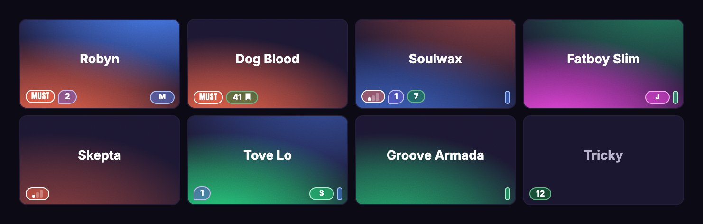

# Festival Navigator

Plan a festival with your friends. One link per crew, everyone's picks on
one wall, live, and it still works in a field with one bar of signal.

**Try it: [fest.kevinhg.com](https://fest.kevinhg.com)**



**Live:** v116, checked 2026-10-19.

The 2026 season is over (Portola in September, ACL in October). Still in
the catalog, with crews already picking: EDC Orlando (Nov 6–8) and Seismic
(Nov 13–15), both lineups waiting on set times, and Tomorrowland Winter
(March 2027). This is a personal project built by Kevin HG for his friends,
in the open.

**Festivals loaded:** 10. The list lives in
[`data/festivals/index.json`](data/festivals/index.json), and only there.
Adding one: [`docs/add-a-festival.md`](docs/add-a-festival.md).

## How it works

- **Your crew is a link.** Every festival board mints an unguessable link
  for its group of friends. The link is the access: no accounts, no
  passwords, no email. Anyone holding it can read and write that board, and
  nobody can touch any other. Different friend groups get different links,
  like real life.
- **Your own link brings it all back.** "My link" on the front page is yours
  alone. Open it on a new phone and every crew you're in comes with it.
- **Inviting is a QR or a text.** "+ Invite someone" opens one sheet: the
  crew link as a QR in the app's own look (a friend points their camera at
  it), a card you can save, or the link to paste into a chat. A pasted link
  unfurls as that festival's own card.
- **The festival's data decides the layout.** While only the lineup is out
  you get a searchable artist list. Where a festival publishes a stage grid,
  that day is a timetable: stage columns on an honest clock, overlaps side by
  side. Everything else (the afters, the late nights, the street party) is a
  stack of cards under the room it happens in, in play order. Picks carry
  over when set times land, because they belong to the artist, not the slot.
- **Board or List.** The menu on the festival's name switches between the
  wall and a time list of rows, per phone and per festival. In the List,
  what's already over folds away behind an "Earlier" line.
- **Tap to open, + and − to pick.** On a phone, a tap opens the card's
  shelf: its facts, `−` and `+` in its bottom corners, and the crew's notes.
  Levels go `picked ×1 → ×2 → ×3 → must`; `+` climbs and `−` steps back.
  With a mouse, hover grows the card and a click cycles the levels. Everyone
  in the crew gets a color, and overlapping picks blend on the card, so you
  can see at a glance where the crew is heading.
- **Our picks.** Just above the bar at the bottom of the screen sits where
  most of the crew will be right now (or next). Drag it up for the day's
  whole route, stop by stop, with the moments the crew splits. "Share our
  picks" sends the day as a few plain lines and a link that opens on it.
- **Notes** go where you are standing: on the festival, on a date, on a
  section on a date (the street fair on Friday), or on an artist. Replies
  thread one level deep, and a note you pin stays on top for you.
- **Import from a festival's own app.** Screenshots of your schedule there
  become picks: Gemini reads only what is printed, your phone matches the
  names, nothing is saved until you add them, and the image is never kept.
- **Cancelled acts stay on the wall,** struck through, with your picks kept
  and the reason when you open the card.
- **Offline first.** Picks save on the phone instantly and sync when signal
  comes back. The server merges every write atomically, so two people picking
  at once never overwrite each other.
- **Spotify, if you want it.** Connect (a sign-in that keeps no secret in
  the browser) and artists you already listen to get a badge; picks can
  become a playlist on your own account. See *Spotify* below; the 2026
  rules are tight.
- **Export.** A day of the wall as a picture, or all your picks as text.

## Privacy, plainly

- No accounts. The crew link is the key to that crew's board, so share it
  like you'd share a group chat, never in public. Your "My link" is a key to
  every crew you're in.
- On the hosted app, crash reports and a short list of usage counts leave
  the phone through one file, [`js/errlog.js`](js/errlog.js). Each carries
  your name in the crew, your phone type and what you tapped, which
  festival you had open, your public person id, a random id for the phone,
  and its screen size and app build, all from an allowlist of fields and
  words. Never note text, artist names or crew links; links and tokens are
  scrubbed out of error messages.
- The same file also counts visits with Vercel's cookie-free Web Analytics,
  on the hosted app only: the page's address with everything after `?` or
  `#` cut off (so never a crew link), plus the rough location, browser and
  device type Vercel works out itself. No cookie, and no IP is kept with
  the count.
- One switch in Settings, "Send crash reports and usage to Kevin", turns it
  all off. A fork on its own domain reports nowhere until it sets its own
  key; run locally, it still reports upstream until that key is changed or
  emptied ([`docs/fork-setup.md`](docs/fork-setup.md)).

## Run it locally

Use Node 24, as CI does (`package.json` pins `engines.node` to `24.x`).
The test tools ask for 24.15.0 or newer on that line (jsdom's own
`engines`); Node 22.22.2 or newer also runs everything, and there `npm ci`
prints an `EBADENGINE` warning about the 24.x pin, which is expected. No
build step: the CSS is hand-written and the JS ships as ES modules.

1. `npm ci`
2. `npm test` runs the unit suite on a pinned clock. It needs no database
   and no secrets: it runs the real merge SQL in-process (PGlite).
3. `npx playwright install chromium webkit` once, then
   `npm run test:browser` for the real-input contracts in Chromium and
   WebKit.

[`tests/README.md`](tests/README.md) explains the pinned clock.

To run the app itself, `npx vercel dev` (the Vercel CLI is not one of this
repo's dependencies; install it globally if you'd rather type
`vercel dev`). Two traps, both real: it does not serve files created after
it started (restart it), and it pulls the real cloud environment, so
`localhost` talks to whatever database `DATABASE_URL` names. Point Development at a database branch, or treat local writes as
production writes.

## Fork it or host your own

Before your first deploy, point the app at yourself in three things:
`index.html`'s `fn-canonical-host` tag (left as is, Spotify sign-in sends
your users' crew links to the upstream domain), its `fn-report-key` tag
(your own PostHog key, or empty), and the link-preview origin (`ORIGIN` in
`api/share.js` and the `og:url` and `og:image` tags in `index.html`; left
as is, every pasted link unfurls from the upstream domain).
[`docs/fork-setup.md`](docs/fork-setup.md) has the exact steps in the order
that keeps the tests green, and the traps a real fork hit.

1. **Deploy to Vercel** (static files and functions).
2. **Create a Postgres database** (the free Neon tier is plenty) and load
   the schema: `psql "$DATABASE_URL" -f db/schema.sql`
3. **Set environment variables:**

   | Variable | Required | What it does |
   |---|---|---|
   | `DATABASE_URL` | **yes** | the crew store |
   | `GEMINI_API_KEY` | no | AI festival research (`api/festival-add.js`) and the schedule-image import (`api/import-schedule.js`) |
   | `GEMINI_MODEL` | no | pins a Gemini model; default `gemini-flash-latest` |
   | `OWNER_SPOTIFY_CLIENT_ID` | no | your Spotify app, offered to your crew |
   | `SLACK_WEBHOOK_URL` | no | where Spotify access requests get sent |
   | `APPROVE_SECRET` | no | signs the approve link in that Slack message |
   | `PUBLIC_BASE_URL` | no | your origin, for that approve link |

   The access-request flow turns on with the three Spotify and Slack
   variables. On your own domain also set `PUBLIC_BASE_URL`: without it the
   server trusts no host to build the approve link for, so no Slack message
   is sent at all (the request is still recorded). Without the three
   variables, members bring their own Spotify Client ID.

## Add a festival

[`docs/add-a-festival.md`](docs/add-a-festival.md) is the format;
[`docs/fest-update-runbook.md`](docs/fest-update-runbook.md) brings one
festival's data up to date without losing anyone's picks. Two commands
matter:

- `node scripts/validate-festivals.mjs` before committing (CI runs it too).
- `node scripts/freeze-pick-keys.mjs <fest-id>` the day real people start
  picking. Artist names are pick keys, so a renamed artist would orphan
  every pick on it; the freeze makes CI catch that.

## Contributing

Ideas, bugs and pull requests are welcome:
[`CONTRIBUTING.md`](CONTRIBUTING.md) has the short version. Found a way to
read a crew you're not in? Please report it privately
([`SECURITY.md`](SECURITY.md)).

## Project structure

Full paths, one per line. `tests/docs-truth.test.mjs` checks that every one
still exists, so this list can't quietly rot.

```
index.html                    app shell: every screen lives here
gallery.html                  every card, wall and zoom state on one page; the browser tests run against it
service-worker.js             offline shell; node scripts/sw-stamp.mjs after any cached-file change
js/v3/app.js                  boot, wiring, screen assembly, sheets
js/v3/wall.js                 the wall: the timetable where a grid is published, venue stacks everywhere else
js/v3/card-facts.js           the card's facts: the zoom (hover, keyboard) and the notes shelf's card (a tap)
js/v3/events.js               the events model: the days, the rooms a day holds, a room's stack in play order
js/v3/motion.js               how this app moves: the shared motion constants
js/v3/settings.js             settings and its drills (Spotify, export, bulk paste)
js/v3/notes.js                notes on a festival, a date, a section on a date, or an artist
js/v3/import.js               picks from a festival app's schedule images
js/v3/model.js                the read model over a crew doc + festival data
js/v3/aura.js                 how a crew's picks blend into one card's color
js/v3/palette.js              the 24-color member board
js/v3/router.js               history-backed navigation
js/state.js                   crew doc + the pending-changes overlay
js/sync.js                    push / poll, retry, and the sync dot's one truth
js/crew.js                    tokens, the local crew registry, share links
js/merge.js                   the deep-merge the client and server agree on
js/errlog.js                  the only door out: crash reports and usage counts, allowlisted
js/overlap.js                 same-stage lane math
js/time.js                    parsing and flooring set times
js/name-rules.mjs             name validation SHARED with the server
api/crew.js                   the crew store: create, read, atomic merge
api/person.js                 the me link: one person across crews (public pid, secret token)
api/access.js                 Spotify access requests (Slack approve flow)
api/festival-add.js           AI lineup research (set times too, once published): returns a candidate; saves it as the crew's own festival once confirmed
api/import-schedule.js        reads a schedule image; returns only what is printed, stores nothing
api/share.js                  per-festival link previews: index.html with its OG tags swapped
api/_lib/                     validation + guards shared by client and server
db/schema.sql                 Neon Postgres schema incl. the atomic jsonb_deep_merge()
assets/v3-tokens.css          design tokens: look values up here, never invent them
assets/v3.css                 components; hand-written, no framework, no build step
assets/mark.svg               the mark: one vector source for every icon and preview
assets/og/                    pre-rendered link previews, one per festival
data/festivals/index.json     the festival list (single source of truth)
data/venues/index.json        the venue registry: each room's usual doors, close and set lengths, with sources
scripts/validate-festivals.mjs  run before committing festival data; CI enforces it
scripts/guess-run-times.mjs   a night's set-time guesses (club or concert) from the venue registry, as a reviewable diff
scripts/brand-assets.mjs      npm run brand: regenerates the icons and every link preview
tests/                        node --test suites (npm test); every test runs on a pinned clock (tests/README.md)
tests/browser/                real-input contracts in Chromium and WebKit (npm run test:browser)
docs/user-flows.md            what every screen is supposed to do
docs/add-a-festival.md        how to add a festival
docs/fest-update-runbook.md   bringing one festival's data up to date without orphaning a pick
docs/fork-setup.md            forking and self-hosting, and the traps a real fork hit
AGENTS.md                     the rules of the repo, for people and coding agents alike
DEVLOG.md                     the story so far, newest first
claude-plans/                 specs, build logs and reviews (claude-plans/README.md is the index)
```

## Sync model

Every pick is saved on the phone at once, then the **change** is pushed to
`/api/crew`, where Postgres merges it into the crew document in a single
atomic `UPDATE` through `jsonb_deep_merge()` (see
[`db/schema.sql`](db/schema.sql)). Because the merge is computed inside the
UPDATE, a second write waits on the row lock and then merges against the
first one's committed row, so two writes can't race by construction.

Other phones poll the merged doc every 25 seconds and again when the app
comes back to the screen. In Low power, or with the phone's Reduce Motion
on (it rides the same switch), the poll stretches to every 5 minutes and
coming back does not jump the queue. Removals sync as **tombstones**
(`removed: true`, and level-`0` picks) because a deep merge can't express
deletion.

Two consequences worth knowing before you change anything here:

- **Notes are keyed objects at every level, never arrays.** `jsonb_deep_merge`
  replaces arrays wholesale, so an array would eat notes written at the same
  time.
- **Vercel Blob is not an option for the crew document.** It was tried first
  and dropped: its reads are eventually consistent and it measurably lost
  writes under rapid merges.

## Spotify

Spotify's February 2026 rules shape this whole feature: a development-mode
app is capped at **5 authorized users**, a developer may hold **one**
development-mode app, and the app's owner needs **Premium**.

So the app offers three doors, in the order most people will use them:

1. **Connect with the crew's app.** If the deployment sets the Spotify and
   Slack variables above, members just connect. The owner adds them to the
   app's allowlist.
2. **Request access.** A member who isn't on the allowlist yet asks; the
   owner gets a Slack message with an approve button that lands on the
   Spotify dashboard's user page.
3. **Bring your own Client ID.** The fork path. If you have your own Spotify
   app, paste its Client ID. Settings has a five-step guide.

## License

No open license. The code is public to read and learn from, and all rights
are reserved (`"license": "UNLICENSED"` in `package.json`); if you'd like to
reuse part of it, ask. The bundled `vendor/html2canvas.min.js` and
`vendor/uqr.mjs` keep their own MIT licenses (their headers are kept), and
the Anton and Inter fonts are under the SIL Open Font License.
